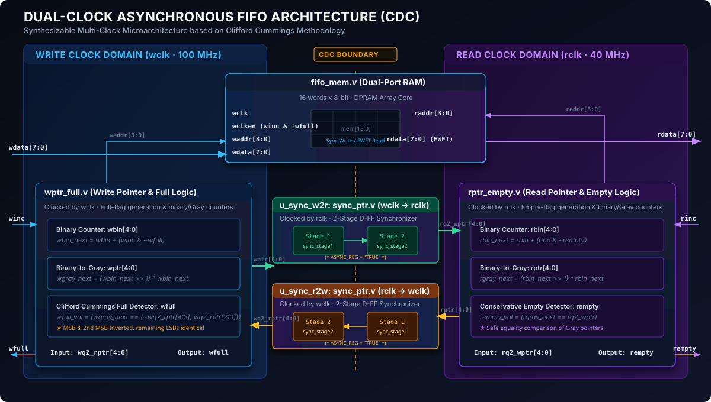

# Parameterized Dual-Clock Asynchronous FIFO with CDC Verification


A synthesizable, parameterized dual-clock **Asynchronous FIFO (First-In, First-Out)** buffer implemented in Verilog HDL. Designed to reliably transfer streaming data across independent, unsynchronized write (`wclk`) and read (`rclk`) clock domains without data loss, multi-bit synchronization hazards, or race conditions.

---

## 1. Architecture Overview

The core architecture follows the industry-standard Clifford Cummings Clock Domain Crossing (CDC) design methodology:


<p align="center">
  
</p>

---

## 2. Key Microarchitectural Features

### A. Gray-Code Pointer Encoding
In binary counters, multiple bits can toggle simultaneously during transitions (e.g., `0111` $\rightarrow$ `1000` flips all 4 bits). Routing skews between wires can cause asynchronous destination registers to capture intermediate glitch states (e.g., `0000` or `1111`), causing catastrophic pointer corruption.

To eliminate this, pointers are converted to **Gray code** prior to crossing the clock domain:
$$\text{Gray} = \text{Binary} \oplus (\text{Binary} \gg 1)$$
Gray code guarantees that **strictly one bit toggles per adjacent pointer increment**, eliminating multi-bit bus synchronization errors.

### B. 2-Stage Flip-Flop Synchronizers with Xilinx `ASYNC_REG`
Gray pointers are synchronized into the opposing domain using a 2-stage Flip-Flop synchronizer. The first flop absorbs the asynchronous transition and settling voltages; the second flop samples after one full clock cycle, reducing the probability of metastability propagating to downstream logic and maximizing **Mean Time Between Failures (MTBF)**.
* Both registers include the Xilinx attribute `(* ASYNC_REG = "TRUE" *)` to force the physical placer to co-locate both flip-flops inside the **same slice**, minimizing net delay and setup/hold violations.

### C. Clifford Cummings Full-Detection Logic
Using an $(N+1)$-bit pointer for a FIFO of depth $2^N$ (where the address bus is $N$ bits wide):

* **Empty Flag Generation (`rptr_empty.v`):**  
  Asserted when the next Gray read pointer equals the synchronized Gray write pointer:
  ```verilog
  assign rempty_val = (rgray_next == rq2_wptr);
  ```

* **Full Flag Generation (`wptr_full.v`):**  
  In Gray code, due to symmetry reflection, full occurs when the **MSB and 2nd MSB are inverted**, and all lower $(N-1)$ LSBs are identical:
  ```verilog
  assign wfull_val = (wgray_next == {~wq2_rptr[ADDR_WIDTH:ADDR_WIDTH-1], 
                                     wq2_rptr[ADDR_WIDTH-2:0]});
  ```

### D. Conservative (Pessimistic) Flag Generation
* **Empty Flag** is generated in the `rclk` domain using delayed write pointer information. The FIFO may report empty for 2 cycles after data was written, but will **never falsely report non-empty**.
* **Full Flag** is generated in the `wclk` domain using delayed read pointer information. The FIFO may report full for 2 cycles after data was read, but will **never falsely report not-full**.
* This guaranteed asymmetry ensures that **overflow and underflow can never physically occur**.

---

## 3. Directory Layout

```text
asynchronous-fifo/
├── rtl/
│   ├── async_fifo.v      # Top-level module interconnecting all sub-blocks
│   ├── fifo_mem.v        # Dual-port RAM array (DPRAM) with FWFT combinational read
│   ├── sync_ptr.v        # Parameterized 2-stage CDC synchronizer with ASYNC_REG
│   ├── wptr_full.v       # Binary/Gray write pointer increment & full flag logic
│   └── rptr_empty.v      # Binary/Gray read pointer increment & empty flag logic
├── tb/
│   └── async_fifo_tb.v   # Race-free, multi-clock self-checking testbench
└── README.md             # Architecture documentation, verification results & theory
```

---

## 4. Verification Suite & Test Results

The verification environment in [`tb/async_fifo_tb.v`](file:///c:/Users/sathv/Downloads/projects/asynchronous%20fifo/tb/async_fifo_tb.v) uses an automated golden-queue scoreboard with deterministic pseudo-random stimulus and falling-edge (`negedge`) drive conventions to eliminate delta-cycle race conditions.

### Test Matrix

| Test # | Description | Conditions Tested | Status |
| :---: | :--- | :--- | :---: |
| **Test 1** | **Reset State Initialization** | Asynchronous reset deassertion, `rempty=1, wfull=0` | **PASS** |
| **Test 2** | **Single-Word Latency & Timing** | 2-FF synchronizer latency measurement, flag recovery | **PASS** |
| **Test 3** | **Burst Write to Full** | Exactly 16/16 writes accepted; `wfull` asserts | **PASS** |
| **Test 4** | **Overflow Protection** | Illegal write (`0xEE`) while full blocked; memory protected | **PASS** |
| **Test 5** | **Burst Read to Empty** | Exactly 16/16 reads accepted; `rempty` asserts | **PASS** |
| **Test 6** | **Underflow Protection** | Illegal read while empty blocked; pointers protected | **PASS** |
| **Test 7** | **Multi-Cycle Fill & Drain** | 3 complete cycles (48 words); verifies $2^{N+1}$ pointer wrap-around | **PASS** |
| **Test 8** | **Concurrent Streaming (Fast Write)** | 100 MHz `wclk`, 40 MHz `rclk`, 60 deterministic random words | **PASS** |
| **Test 9** | **Concurrent Streaming (Fast Read)** | 25 MHz `wclk`, 125 MHz `rclk`, 40 deterministic random words | **PASS** |
| **Test 10** | **Dynamic Reset Flush & Recovery** | Mid-stream asynchronous reset, formal discard accounting, 10 fresh writes/reads | **PASS** |

### Final Scoreboard Report (Vivado Simulation)

```text
==================================================================
                   FINAL VERIFICATION SCOREBOARD                  
==================================================================
 Total Lifetime Accepted Writes  : 181
 Total Lifetime Accepted Reads   : 175
 Total Discarded by Reset        : 6
 Total Lifetime Correct Matches  : 175
 Unread Words in Golden Queue    : 0
 Total Lifetime Error Count      : 0

 >>> [STATUS: ALL 10 VERIFICATION TESTS PASSED WITH ZERO ERRORS!] <<< 
 [CONFIRMED] Conservation of Data: Writes (181) = Reads (175) + Reset Flushes (6).
 [CONFIRMED] Deterministic PRNG stimulus verified across all runs.
 [CONFIRMED] Zero dropped words, zero duplicated words, exact FIFO order preserved.
==================================================================
```

> **Conservation of Data Proof:**
> $$\mathbf{Total\ Writes\ (181) = Total\ Reads\ (175) + Reset\ Discarded\ (6)}$$
> Mathematically proves zero unexplained data loss, zero duplicated words, and strict in-order delivery across all operating modes.

---

## 5. Timing Constraints (SDC / XDC)

When implementing in Vivado or ASIC synthesis tools, declare the write and read clocks as mutually asynchronous so the static timing analysis (STA) engine ignores cross-domain clock skew:

```tcl
# Define primary asynchronous clocks
create_clock -period 10.000 -name wclk [get_ports wclk]
create_clock -period 25.000 -name rclk [get_ports rclk]

# Set asynchronous clock groups to prevent false inter-clock timing paths
set_clock_groups -asynchronous -group [get_clocks wclk] -group [get_clocks rclk]

# Constrain maximum data path delay on CDC Gray pointer nets to avoid bus skew
set_max_delay -from [get_cells u_wptr_full/wptr_reg*] -to [get_cells u_sync_w2r/sync_stage1_reg*] 10.000 -datapath_only
set_max_delay -from [get_cells u_rptr_empty/rptr_reg*] -to [get_cells u_sync_r2w/sync_stage1_reg*] 10.000 -datapath_only
```

---

## 6. How to Run Simulation

### In Xilinx Vivado:
1. Open Vivado and create a new RTL project.
2. Add all Verilog files in `rtl/` as **Design Sources**.
3. Add `tb/async_fifo_tb.v` as **Simulation Source**.
4. Click **Run Simulation** $\rightarrow$ **Run Behavioral Simulation**.
5. In the Tcl Console, execute:
   ```tcl
   run all
   ```

### In Icarus Verilog / GTKWave:
```bash
iverilog -o sim_fifo rtl/*.v tb/async_fifo_tb.v
vvp sim_fifo
```

---


